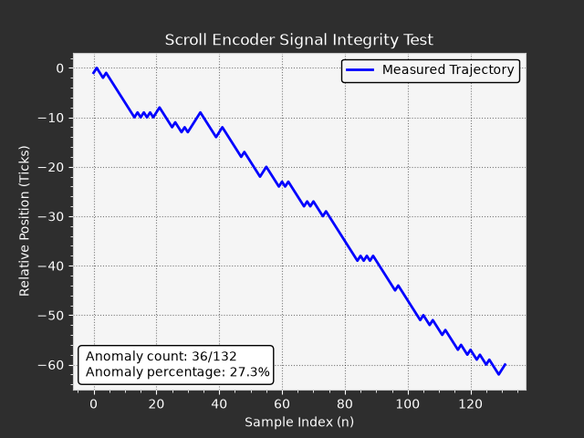

# Scroll Encoder Signal Integrity Diagnostic Tool

A lightweight Python tool designed to analyze the signal integrity and directional stability of mechanical/optical mouse scroll wheel encoders. By capturing low-level OS scroll events, the script plots the actual displacement trajectory and calculates the error rate caused by mechanical wear, contact bounce, or signal chatter.

## Features
- **Real-Time Data Acquisition:** Captures discrete scroll inputs over a fixed 5-second sampling window.
- **Signal Integrity Metrics:** Computes the total number of directional faults and outputs an exact Error Rate percentage.
- **Visualization:** Generates a clean, laboratory-style trajectory plot using Matplotlib, optimized for dark-mode documentation.

## How It Works
In a healthy quadrature encoder, a continuous physical rotation in one direction should yield a monotonic sequence of directional pulses. Due to mechanical degradation, debris, or contact chattering, the encoder frequently misreports the direction. This script catches every inverse pulse as a **Directional Fault**, which visually appears as a "sawtooth" anomaly on the trajectory graph.

## Libraries & Installation

Ensure you have Python 3.x installed. Then, install the required packages:

```bash
pip install matplotlib pynput
```

## Usage

1. Run the script:
   ```bash
   python main.py
   ```
2. Immediately start scrolling **DOWN** continuously and at a steady pace for 5 seconds.
3. The terminal will log the acquisition window, and a diagnostic chart will automatically render.

## Sample Output



## License
MIT License